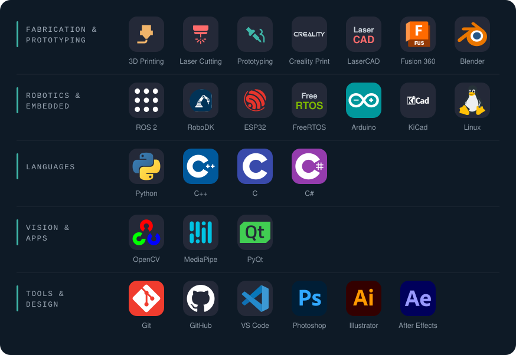
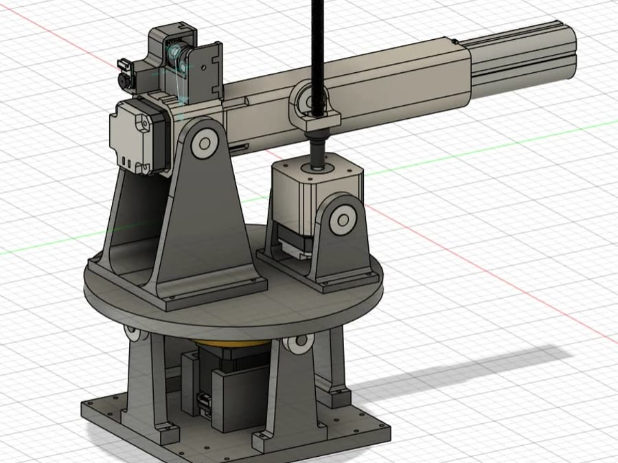
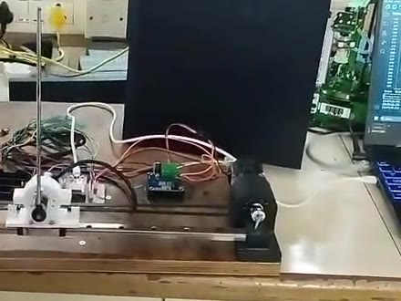

  

<table>
<tr>
<td width="50%" valign="top">

<h4><code>ms@blackflag:~$ whoami</code></h4>

<code>&gt; B.E. Robotics '27 @ VESIT</code> 
<code>&gt; firmware · control · prototyping</code> 
<code>&gt; co-founder @ Prixie 3D</code> 
<code>&gt; open to work · Jan–Jun 2027</code>

</td>
<td width="50%" valign="top">

<h4><code>ms@blackflag:~$ cat now.log</code></h4>

<code>&gt; Botswain: open-source cobot app</code> 
<code>&gt; SLI rig: alarms in hardware testing</code> 
<code>&gt; learning: ROS 2 sim, Sim2Real</code> 
<code>&gt; mosalah.tech · LinkedIn · email ↓</code>

</td>
</tr>
</table>

I build robots that have to work outside the simulator. Most of my time goes into the gap between a clean design and real hardware: noisy IMUs, brownouts, servos that don't have the torque the datasheet promised. I like taking a vague requirement and turning it into something that runs, usually with a 3D printer, a laser cutter and a soldering iron within reach.

## Tech stack

  

## Experience

| Role | Where | When |
|---|---|---|
| Co-founder | Prixie 3D, Navi Mumbai | 2026 to now |
| R&D Researcher (Top 30 all-India) | InventX, IIT Jammu | Jun to Jul 2026 |
| Electronic Med-Tech Project Intern | Hydralite, Mumbai | Dec 2025 to Jun 2026 |
| Robotics Software Intern | Accelus Robotics, Mumbai | Aug 2025 to Jan 2026 |

## Featured

<table>
<tr>
<td width="50%" valign="top">

<h4><a href="https://github.com/1tsMS/advanced-sli-crane-system-personal-repo">Advanced Safe Load Indicator</a></h4>
Closed-loop SLI for cranes on an ESP32 with FreeRTOS. Reads IMU, load cell and outrigger sensors for safety limits, anti-sway and tipping prediction, with a live dashboard. Runs end to end on a crane-replica rig.  
<code>ESP32</code> <code>FreeRTOS</code> <code>ESP-NOW</code> <code>IMU</code> <code>load cell</code>
</td>
<td width="50%" valign="top">

<h4><a href="https://github.com/1tsMS/Inverted_Pendulum">Micro Inverted Pendulum</a></h4>
Cart-pole on a GT2 belt and linear rail. Cascade PID on an ESP32 with encoder feedback, tuned for fast stabilization.  
<code>ESP32</code> <code>cascade PID</code> <code>encoders</code> <code>linear rail</code>
</td>
</tr>
</table>

**More builds**
- [Crane inertial analysis](https://github.com/1tsMS/-Safe-Load-Indicator-using-Inertial-Sensor-Analysis): the 2025 version of the SLI, tested on a real Escorts F15 crane
- [ESP-NOW walkie-talkie](https://github.com/1tsMS/ESP32-ESP-NOW-Walkie-Talkie): two ESP32s streaming I2S audio with no router
- [Fall detection](https://github.com/1tsMS/Fall_Detection): helmet or belt mounted, MPU6050 + ESP-NOW + Blynk SOS
- [Paint booth sim](https://github.com/1tsMS/paint-booth-sim): RoboDK car-painting cell
- [Botswain](https://github.com/1tsMS/botswain): open-source unified cobot app, in development

## Recognition

- **1st place**, RoboAnalyzer Competition, IIT Delhi
- **2nd place**, VES HACK-IT 30-hour hardware hackathon
- **2nd place**, Hack-AI-Thon 4.0
- **Top 50**, AgriTech Hackathon, K.J. Somaiya

  

